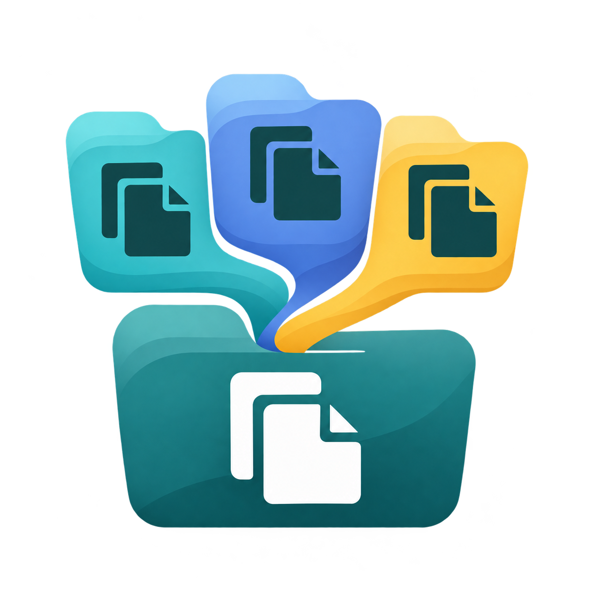

# Folderloom

A desktop workspace for consolidating overlapping folder collections. Explore several folders, review where their files will go, then copy approved additions into a primary destination and verify the results.

**2026.11.3 · macOS development build · saved jobs and guided consolidation**

The graphical app scans, compares, saves folder mappings and merge decisions, and copies an approved plan with destination verification. It keeps original source files in place. Source cleanup and recovery remain separate future work.

## Start or reopen a job

Folderloom opens to **Jobs**, a table of saved scans and consolidation jobs. Open a row to resume its saved stage, or choose **New job**. No account or login is required. Choose **Archive** to move a finished job out of Current; use **Archived → Restore** to bring it back. Archiving retains its saved history, source files, and destination files. Archived jobs offer **Delete permanently** to free their local database space after confirmation; this deletes saved job records only, never source folders or copied files.

1. **Sources:** name the job and add its source folders. **Remove** only removes a folder from this setup; it never deletes files. Unstarted setup with entered choices is saved locally as a draft. **Save & close** keeps it for later; **Cancel setup** discards it. Empty setups do not create a pending draft.
2. **Primary destination:** choose an existing folder, empty or populated, or use a listed folder as primary. Its contents stay in place. The primary is excluded from incoming sources.
3. **Scan and compare:** start the scan, expand folders to explore their files, and compare contents. Matching-location dropdowns show every observed matching placement. Pause and resume saved work as needed.
4. **Merge plan:** choose incoming folders and target subfolders, build the plan, and review every exact output path. Exclude unwanted items and approve the displayed revision. Matching contents at the same output path share one placement; differing contents get previewed conflict names.
5. **Results:** copy approved additions and inspect verified files, folders, exceptions and excluded items. Retry or resume unfinished work. **Open destination** opens the output folder.

A started job retains its scanned source set and history. Choose **Use as new job** to change or remove sources without rewriting that job's evidence. **Jobs** returns to the saved-job table. Only one filesystem operation runs at a time.

```text
Copy 1
  ▾ Project
      ▾ Documents
          report.pdf
Copy 2
  ▾ Project backup
      report.pdf
      notes.txt
```

Every placement remains visible even when contents match. Partial samples screen candidates; only completed full hashes are shown as full-hash evidence. A match does not authorize deletion. Equal contents at different planned output paths retain both placements.

**Pause** saves a checkpoint. Resume the scan or comparison when ready. The app starts at the saved-job table; opening a job reloads its durable state. **Re-scan** checks the saved sources again, refreshes the inventory, and invalidates old comparison evidence. Run **Compare contents** again for fresh evidence. **Recover / Resume** handles a saved job that needs SQLite recovery.

## Local files, local database

Folderloom bundles its interface inside a native desktop window. There is no hosted backend, external font download, or source-content upload.

SQLite is bundled with the app: using a packaged app requires no database server, Rust, Node, or Python installation. The app creates its data directory automatically. Each job uses its own **SQLite database**; files stay in their source folders. On macOS, the demo stores jobs under `~/Library/Application Support/com.folderloom.demo/jobs/`. Previous databases remain on disk when a new scan starts. The Jobs table opens these retained jobs. Job names, initial destinations and the current setup draft use small local metadata files alongside the SQLite jobs. Cross-machine project portability is not implemented yet.

The demo loads the full inventory. Opening every folder or running a broad search can render every entry, so use small, bounded collections for now. Large-library responsiveness, direct NAS performance, and Windows support have not been validated. NAS folders must be mounted and accessible to the operating system before they can be selected.

## Build the desktop app

This is a development demo, not a signed or notarized downloadable release. Standalone packaging currently targets Apple silicon macOS. With Node 22.12+, npm, Rust, Python 3.9+, Rust's documentation component, and the macOS native build prerequisites installed:

```sh
cd apps/desktop
npm ci
cargo fetch --locked
npm run tauri dev
```

To build an application that opens without a development server:

```sh
npm run tauri build -- --bundles app
```

Open `target/release/bundle/macos/Folderloom Demo.app` from the repository root, or the equivalent path under your custom `CARGO_TARGET_DIR`. See [desktop development](docs/desktop-development.md) for private demo configuration and build details, and [engine and CLI development](docs/development.md) for command-line operations and core validation.

## Where this is going

This build uses explicitly selected manual folder mappings. Automatic folder-matching suggestions, richer snapshot-preservation behavior, and separately reviewed cleanup/recovery remain future work. Links and unsupported entries are held visibly. Directory metadata preservation is limited; inspect the per-item details. Regular-file metadata is copied on macOS, including extended attributes such as quarantine. Byte verification is not malware scanning. See the [consolidation workflow and limits](docs/consolidation-workflow.md).

The shared Rust engine drives both the desktop app and development CLI. Folderloom uses its own workflow and established libraries; it is not a Czkawka fork.

- [Product specification](docs/SPEC.md) and [tracking issue](https://github.com/mk11232/folderloom/issues/1)
- [Saved jobs and wizard](docs/jobs-workflow.md), [validation](docs/jobs-validation.md), and [tracking issue](https://github.com/mk11232/folderloom/issues/11)
- [Reviewed consolidation build](https://github.com/mk11232/folderloom/issues/9) and [broader folder-matching milestone](https://github.com/mk11232/folderloom/issues/5)
- [Architecture](docs/DESIGN.md), [desktop decision](docs/adr/0001-desktop-shell-and-reusable-rust-core.md), and [glossary](GLOSSARY.md)
- [Consolidation validation](docs/consolidation-validation.md), [earlier desktop validation](docs/desktop-validation.md), and [Czkawka evaluation](docs/czkawka-evaluation.md)

## Versions and contributions

Versions use CalVer **YYYY.M.release**: `2026.11.1`, `2026.11.2`, then `2026.12.1`. Each month's first published release starts at 1; months have no leading zero. This is a release identifier, not a promise of stable APIs or database compatibility. See [release practices](docs/releases.md).

Use synthetic development fixtures. Keep real files, client information, source inventories, job databases, and private screenshots outside the repository. Contributions must preserve the separation between review, copying, verification, and source cleanup.

## License and artwork

The current code and documentation are under the [MIT License](LICENSE). Dependencies retain their own terms. Interface icons use Lucide; the application icon is user-supplied artwork selected during the design process. See [dependency and artwork notices](docs/licensing.md) for exact versions, bundled notices, source-availability links, and upstream qualifications.
